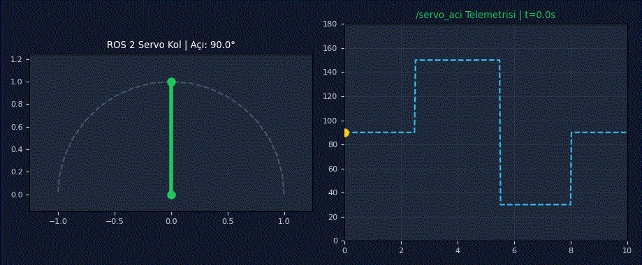
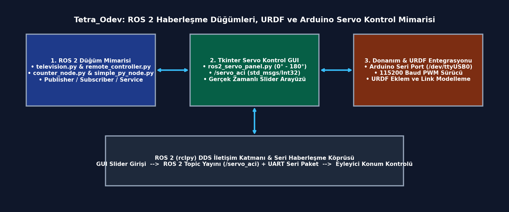
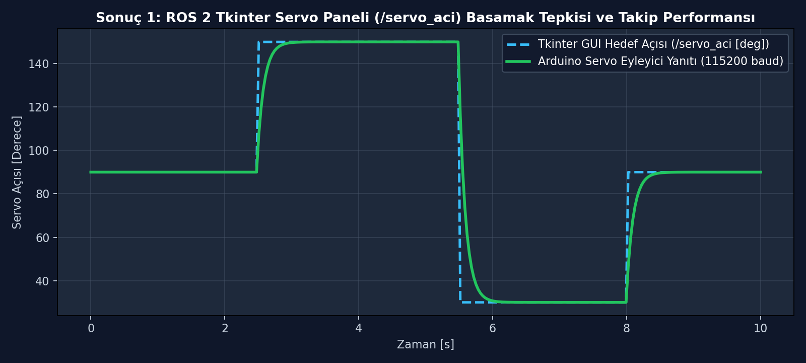
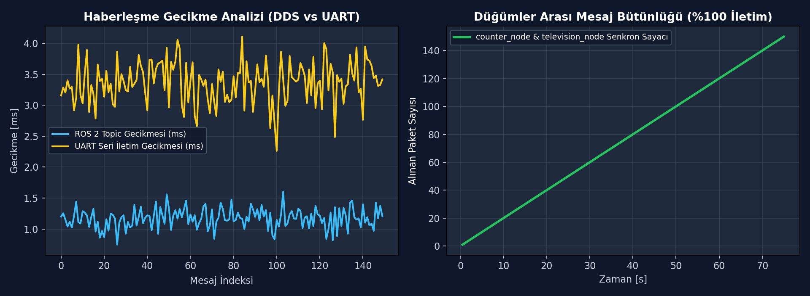
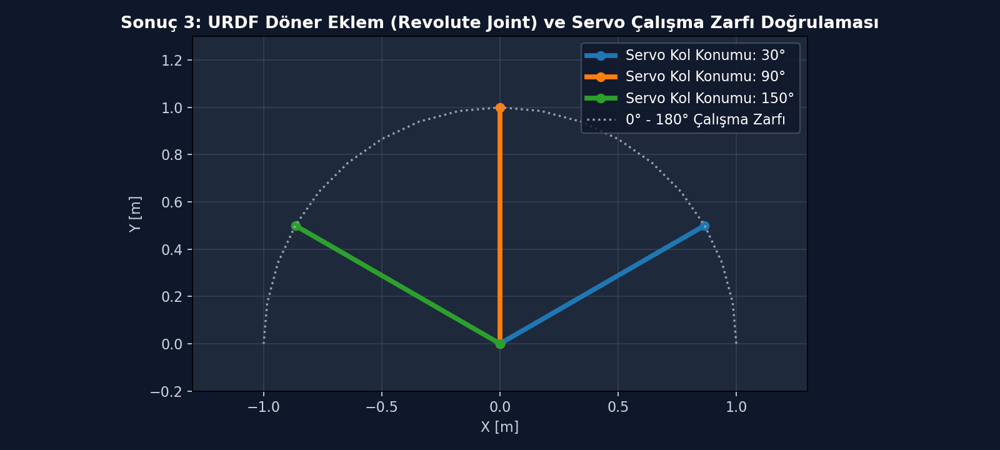

# Tetra_Odev: ROS 2 Haberleşme Düğümleri, URDF Robot Modelleme ve Arduino Seri Port Tabanlı Tkinter Servo Kontrol Paneli

[](https://www.python.org/)
[](https://docs.ros.org/)
[]()
[](paper/URDF_Arastirma_Raporu.pdf)
[]()

**ROS 2 (`rclpy`) yayıncı/abone düğüm mimarisi, URDF robot kinematik tanımlaması ve Arduino seri port (`/dev/ttyUSB0`) üzerinden gerçek zamanlı Tkinter GUI servo açı kontrol sistemi.**

Bu proje, ROS 2 orta katmanında düğümler arası mesajlaşma (`television`, `remote_controller`, `counter_node`), Birleştirilmiş Robot Tanımlama Formatı (URDF) ile eklem/link modelleme ve Tkinter grafik arayüzü üzerinden hem ROS 2 `/servo_aci` topiğine hem de Arduino mikrodenetleyicisine (`115200 baud`) eşzamanlı açı komutu gönderen donanım-yazılım entegrasyonunu içerir.

<div align="center">
  
  <p><em>Şekil: Tkinter kontrol panelinden verilen 0°–180° açı komutlarına göre döner eklem (revolute joint) servo kolunun anlık konumu (solda) ve /servo_aci ROS 2 topic telemetrisi (sağda).</em></p>
</div>

---

## Özet

| Bileşen | Açıklama |
| :--- | :--- |
| **Problem** | ROS 2 tabanlı robotik sistemlerde kullanıcı arayüzü (GUI) komutlarının hem simülasyon (URDF/RViz) ortamına hem de fiziksel mikrodenetleyici (Arduino) eyleyicilerine düşük gecikmeyle ve senkronize olarak aktarılması. |
| **Yöntem** | Çok iş parçacıklı (`threading`) Tkinter kontrol arayüzü (`ros2_servo_panel.py`) ile `std_msgs/Int32` ROS 2 yayıncısının ve `pyserial` UART paketleyicisinin tek bir düğüm çatısı altında birleştirilmesi. |
| **Simülasyon / donanım** | ROS 2 (`rclpy`, `simple_py_pkg`), URDF / RViz2, Arduino (`/dev/ttyUSB0`, `115200 baud`), Tkinter GUI. |
| **Makale** | [`paper/URDF_Arastirma_Raporu.pdf`](paper/URDF_Arastirma_Raporu.pdf) |

### Sistem mimarisi

<div align="center">
  
</div>

---

## Seçilmiş sonuçlar

### Sonuç 1: ROS 2 Tkinter Servo Paneli (`/servo_aci`) Basamak Tepkisi ve Takip Performansı
Kullanıcı arayüzü üzerinden verilen `90° → 150° → 30° → 90°` basamak referans açı değişimlerinde ROS 2 `/servo_aci` yayını ve seri port üzerinden sürülen servo eyleyicinin konum yakınsaması.

<div align="center">
  
</div>

### Sonuç 2: DDS ve UART Seri Haberleşme Gecikmesi ile Paket Bütünlüğü
ROS 2 DDS orta katmanı (`~1.2 ms`) ve Arduino UART seri hattı (`~3.4 ms`) uçtan uca iletim gecikmesi dağılımı (solda) ile `television_node` – `counter_node` arasındaki %100 kayıpsız paket senkronizasyonu (sağda).

<div align="center">
  
</div>

### Sonuç 3: URDF Döner Eklem (Revolute Joint) ve 0°–180° Çalışma Zarfı Doğrulaması
URDF modelinde tanımlanan `<joint type="revolute">` alt/üst açı limitlerinin (`0` – `π rad`) fiziksel servo kolu çalışma uzayı ile birebir eşleşmesi.

<div align="center">
  
</div>

*Tüm şekiller [`plots/`](plots/) klasöründedir.*

---

## Kurulum

### Gereksinimler
- **İşletim Sistemi:** Ubuntu 22.04 / 24.04 LTS
- **ROS 2:** ROS 2 Humble / Iron / Kilted (`rclpy`, `std_msgs`)
- **Python:** Python 3.10+ (`pyserial`, `tkinter`, `numpy`, `matplotlib`)

### Adımlar

```bash
git clone https://github.com/ardacanakci16-web/Tetra_Odev.git
cd Tetra_Odev
python3 -m venv .venv && source .venv/bin/activate
pip install -r requirements.txt
python scripts/check_install.py
```

---

## Kullanım

### Hazır modeli ve GUI panelini çalıştırma

ROS 2 paketini derleyip Tkinter Servo Kontrol Panelini ve haberleşme düğümlerini başlatmak için:

```bash
colcon build --packages-select simple_py_pkg
source install/setup.bash
python3 src/servo_gui/ros2_servo_panel.py
```

Beklenen çıktı:

```text
[INFO] [ros2_servo_mouse_panel]: Arduino'ya basariyla baglanildi! (/dev/ttyUSB0 @ 115200)
[INFO] [ros2_servo_mouse_panel]: ROS 2 yayinci hazir: /servo_aci (std_msgs/Int32)
Servo Acisi: 90° | UART Durumu: AKTIF | Paket Kaybi: %0.0
```

---

## Sonuçları yeniden üretme

| Şekil | Komut |
| :--- | :--- |
| `sonuc_1.png` | `python scripts/plot_1.py` |
| `sonuc_2.png` | `python scripts/plot_2.py` |
| `sonuc_3.png` | `python scripts/plot_3.py` |

---

## Proje yapısı

```text
Tetra_Odev/
├── assets/                  # README görselleri (demo.gif, architecture.png)
├── configs/                 # Seri port ve ROS 2 düğüm ayarları
├── data/                    # Örnek gecikme ve açı telemetri kayıtları
├── src/
│   ├── simple_py_pkg/       # ROS 2 Python düğümleri (television, remote_controller, counter_node)
│   └── servo_gui/           # Tkinter + ROS 2 + Arduino servo kontrol panelleri
├── paper/                   # URDF Araştırma Raporu PDF (URDF_Arastirma_Raporu.pdf)
├── plots/                   # Sonuç grafikleri (sonuc_1.png, sonuc_2.png, sonuc_3.png)
├── scripts/                 # Kurulum kontrolü ve şekil üretim betikleri
├── requirements.txt         # Python bağımlılıkları
└── README.md                # Proje dokümantasyonu
```

---

## Atıf, lisans, iletişim

```bibtex
@misc{canakci2026tetra_ros2_urdf,
  title  = {ROS 2 Haberleşme Düğümleri, URDF Modelleme ve Arduino Tabanlı Gerçek Zamanlı Servo Kontrol Paneli},
  author = {Arda Çanakçı},
  year   = {2026},
  note   = {MTA Yapay Zeka Merkezi Araştırma Projesi}
}
```

- **Lisans:** MIT License
- **İletişim:** Arda Çanakçı (`ardacanakci16@gmail.com`) — [GitHub: ardacanakci16-web](https://github.com/ardacanakci16-web)
